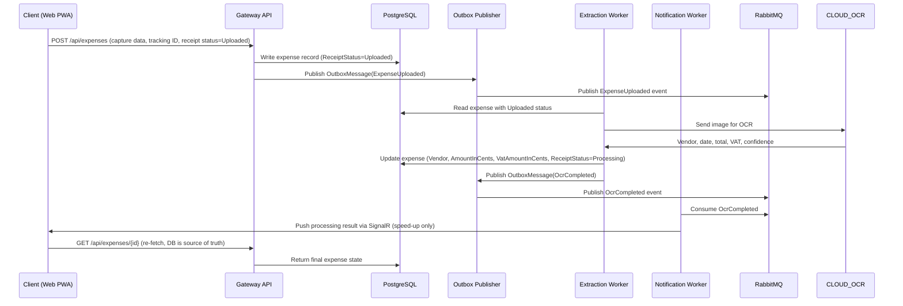

# SARS Expense Companion - Architecture Document

**Version:** 1.0 (draft)  
**Date:** 2026-11-23  
**Based on:** Product-Requirements.md v1.0, Codebase analysis (2026-11-23)  
**Owner:** Product / Architecture

---
## Table of Contents

## 1. System Overview

## 2. High-Level Architecture

```mermaid
graph TD
    %% Client Layer
## 3. Service Architecture

### 3.1 Companion.Api (Gateway API)

**Responsibilities:**
- Identity and access management (Auth, RBAC, JWT)
- Expense CRUD operations with billing entitlement checking
### 3.2 Companion.Extraction

**Responsibilities:**
- OCR processing pipeline for receipt images
- Stuck `Processing` sweeper: 5-minute timeout, 3 retries
- Low-confidence results routing to manual entry
- `entry_origin` tracking: System_OCR / User_Manual / User_Override
### 3.3 Companion.Notification

**Responsibilities:**
- Email delivery via Resend (sole email provider)
- Template rendering for verification and reset emails
- RabbitMQ event consumption (outbox-based)
- Channel abstraction (`INotificationChannel`) with per-channel on/off flags
### 3.4 Companion.Reporting

**Responsibilities:**
- Ad-hoc report generation (PDF/DOCX)
- Scheduled/recurring reports
- `202 Accepted` + task ID response (non-blocking client)
- Report delivery: email or stored for download
### 3.5 Companion.Scheduler

**Responsibilities:**
- Stuck `Processing` record sweeper
- 5-minute timeout per record
- 3 retries maximum
- Runs as standalone hosted service
### 3.6 Companion.Realtime (SignalR)

**Responsibilities:**
- Push processing results to connected clients
- Speed-up only; DB is the source of truth (NT-04)
- Backplane for distributed deployments

## 4. Data Architecture

### 4.1 Database Overview

| Property | Value |
|----------|-------|
| **Database** | PostgreSQL 17 |
| **Schema** | Single shared, flat schema (no database-per-service) |
| **ORM** | EF Core Code-First |
| **Migrations** | Applied at gateway startup via `ApplyCompanionMigrationsAsync` |
| **Migration Location** | `Companion.Data/Migrations/` |
| **PK Strategy** | int internally; Guid (PublicId) externally |
| **Money** | `long` cents (`AmountInCents`) end-to-end; rand conversion in UI only |
| **Receipt Status** | `None / Uploaded / Processing / Qualified / Rejected` (backend-canonical) |
| **IDs** | int PK internally; `PublicId` (Guid) externally exposed |
## 5. Messaging Architecture

### 5.1 RabbitMQ Configuration

| Property | Value |
|----------|-------|
| **Broker** | RabbitMQ (via `Companion.Messaging` / EasyNetQ) |
| **Access** | All services via `Companion.Messaging` library only |
| **Conventions** | Default EasyNetQ conventions (automatic topic/exchange) |
| **Outbox Pattern** | Transactional outbox + reconciliation sweeper (MVP) |
| **Polling Interval** | 1000ms (`OutboxPollingIntervalMilliseconds` in appsettings) |
| **DLQ** | Dead-letter queue support (poison message handling) |

### 5.2 Event Types

## 6. Frontend Architecture

### 6.1 Technology Stack

| Layer | Technology | Version | Purpose |
|-------|------------|---------|---------|
| **Framework** | TanStack Start | 1.168.60 | SSR/SSG (Vite-based) |
| **UI Library** | React | 19.2.0 | Component rendering |
| **Routing** | TanStack React Router | 1.170.41 | File-based routing |
| **State Query** | TanStack React Query | 5.83.0 | Data fetching, caching, updates |
| **Styling** | TailwindCSS | 4.2.1 | Utility-first CSS |
| **Components** | Radix UI | Various | Accessible primitives |
| **Icons** | lucide-react | 0.575.0 | Icon set |
| **Theme** | next-themes | - | 2-state (light/dark) toggle |
| **Build** | Vite | 7.3.1 | Dev server + production build |
| **Cloudflare** | `@cloudflare/vite-plugin` | 1.25.5 | R2 presigned URL support |
| **Fonts** | `@fontsource-variable/bricolage-grotesque` | 5.3.0 | Headings font |
| **Fonts** | `@fontsource/ibm-plex-mono` | 5.3.0 | Amounts/tax details font |

### 6.2 Route Structure
## 7. Architecture Constraints

### 7.1 Core Constraints (from §8 of Product Requirements)

| # | Constraint | Status | Notes |
|---|------------|--------|-------|
| 1 | Client-server, strictly decoupled | ✅ | API contract is only dependency |
| 2 | Single shared PostgreSQL 17, flat schema | ✅ | EF Core migrations in Companion.Data |
| 3 | Services: Gateway API + Extraction + Notification + Realtime + Reporting + Scheduler | ✅ | Defined in §8 |
| 4 | All RabbitMQ access via `Companion.Messaging` | ✅ | EasyNetQ default conventions |
| 5 | Native AOT is the target | ⚠️ | QuestPDF and Open XML SDK AOT compatibility unverified |
| 6 | Local: `dotnet run` against local Postgres/RabbitMQ/Seq | ✅ | `appsettings.Development.json` gitignored |
| 7 | Deployment: docker-compose with `secrets/` pattern | ✅ | Defined in §8 |
| 8 | Money: `long` cents end-to-end | ✅ | Rand conversion in UI only |
| 9 | Receipt status: `None/Uploaded/Processing/Qualified/Rejected` | ✅ | Backend-canonical |
| 10 | IDs: int PK internally; `PublicId` (Guid) externally | ✅ | Never int PKs in API/JWT/URLs |

### 7.2 Design Constraints (from §10 of Product Requirements)

| Aspect | Decision |
## 8. Current State vs Requirements

### 8.1 Implementation Gap Summary

| Category | Requirements Status | Implementation Status | Gap |
|----------|--------------------|----------------------|-----|
| **Auth (ID-01 to ID-08)** | Mostly [Decided] | Partial: register, login, basic profile | Email verification no delivery; password reset no delivery; RBAC partially; security stamp check [Reported] |
| **Capture (CP-01 to CP-08)** | Mostly [Decided] | Mock flow only | CP-07: Photos lost on tab close; CP-04: R2 upload flow partially; CP-05: Outbox not wired |
| **Extraction (EX-01 to EX-08)** | Mixed [Decided]/[Open] | Worker idle | No OCR pipeline; EX-07: confidence threshold open; EX-08: sweeper not running |
| **Expense (EM-01 to EM-07)** | Mixed [Decided]/[Open] | Basic structure | EM-04: Duplicate detection logic open; EM-06: Free-tier cap enforcement |
| **Dashboard/Gallery (DB-01, GL-01)** | Mixed [Decided]/[Open] | Mock data only | Exact metrics open; lazy-loaded WebP thumbnails partially |
| **Reporting (RP-01 to RP-07)** | Mixed [Decided]/[Open] | CSV/JSON samples | RP-05: Free PDF only vs homepage CSV conflict; RP-07: CSV export conflict |
| **Notifications (NT-01 to NT-06)** | Mixed [Decided]/[Open] | Templates built | NT-03: Channel abstraction not built; NT-05: Plaintext tokens risk; NT-06: Reminders not built |
| **Billing (BL-01 to BL-05)** | Mixed [Decided]/[Open] | Pricing page | BL-02: PayFast not integrated; BL-03/BL-04: entitlement middleware ambiguous |
| **Workspace (WS-01, WS-02)** | Mixed [Decided]/[Open] | Business type enum, cap 5 | ID-11: Owner/member roles undefined; no workspace API |
| **Tests** | [Decided] | 12 of 71 passing | 59 failed (mostly outbox/publisher/poison message tests) |

### 8.2 Standing Coverage Checklist Gaps

| # | Item | Coverage | Gap |
|---|------|----------|-----|
| 1 | Onboarding | Mock signup only | No first-run flow: workspace setup, business type, VAT status, first-capture prompt |
| 2 | Sign up and log in | Backend slice [Reported]; frontend mock | Verify against code; social login backend undecided |
| 3 | Email verification | OTP flow decided and [Reported] built | **No outbox relay or email delivery** → non-functional end to end |
| 4 | Password reset | Forgot/reset [Reported] built | Same delivery gap as #3 |
| 5 | Account deletion | Erasure/anonymisation in TRS v1.2 only | No decision, no API, no UI. POPIA-relevant |
| 6 | User permissions | Platform RBAC decided | Workspace-level roles for 5-member Premium undefined; enforcement phase (G3) not started |
| 7 | Empty states | None specified | Define for dashboard, gallery, reports |
| 8 | Loading states | Receipt pipeline states decided | Other screens unspecified |
| 9 | Error states | Receipt `Failed` state decided | Global error, auth failure, quota-exceeded, upload failure UX unspecified |
| 10 | Network states | Polling fallback and refetch decided for receipts | Offline capture, upload resume, and PWA offline behaviour undefined |
| 11 | Data persistence | DB is source of truth; draft-before-upload decided | **Mock capture holds photos in tab memory; no draft recovery after tab close** |
| 12 | Payment flow | PayFast and trial/downgrade rules decided | Nothing built; pricing not final; failed-payment and dunning behaviour undefined |
| 13 | Notifications | Resend email decided; WhatsApp future | Notification content catalogue and reminder rules undefined |
| 14 | Analytics | None | No product analytics decision. Needs POPIA consent handling |
| 15 | Crash reporting | Seq for backend logs | Frontend error path undefined since client-errors route was removed (2026-10-18) |
| 16 | Privacy set-up | POPIA consent field; privacy/terms/POPIA pages exist | Cross-border storage review deferred (R-2); retention policy undefined |
| 17 | Accessibility | Reduced-motion fallback | No conformance target, no audit |
| 18 | Responsiveness | 375px baseline | Tablet/desktop breakpoints unspecified |
| 19 | User flows | Pipelines documented at architecture level | No end-to-end user-flow document |
## 9. Integration Points

### 9.1 Client ↔ Gateway Integration

| Direction | Method | Authentication | Notes |
|-----------|--------|----------------|-------|
| Client → Gateway | HTTPS POST | JWT Bearer token in Authorization header | Security stamp checked on every request (ID-07) |
| Client → Gateway | HTTPS GET | JWT Bearer token | Profile endpoint validates PublicId matches subject (Program.cs:162) |
| Client → Gateway | HTTPS PUT | JWT Bearer token | Profile update with subject validation (Program.cs:175) |
| Client → Gateway | WebSocket (SignalR) | Connected via JWT auth | Push processing results (NT-04); source of truth = DB |

### 9.2 Gateway ↔ Database

| Operation | Technology | Notes |
|-----------|-----------|-------|
| Migrations | EF Core `dotnet-ef` | Applied at gateway startup via `ApplyCompanionMigrationsAsync` |
| Reads | EF Core DbContext (`CompanionDbContext`) | Single shared context, flat schema |
| Writes | EF Core DbContext | All services share schema; int PKs, PublicId GUIDs externally |
| Money amounts | `long` cents | UI converts to rand display; DB stores cents |
| Receipt status | `ReceiptStatus` enum | Backend-canonical: None/Uploaded/Processing/Qualified/Rejected |

### 9.3 Gateway ↔ RabbitMQ

| Flow | Description |
|------|-------------|
| **Outbox Publish** | Gateway writes event + outbox row in same DB transaction; publisher service picks up and publishes to RabbitMQ |
| **Notification Consumption** | Worker subscribes to `EmailVerificationRequested` / `PasswordResetRequested`; renders template; sends via Resend |
| **Extraction Events** | When OCR pipeline wired: worker publishes `ExpenseProcessed` events |
| **Report Events** | When reporting wired: worker publishes `ReportGenerated` events |
| **Scheduler Signals** | Scheduler detects stuck `Processing` records; publishes retry signals |

### 9.4 Client ↔ Cloudflare R2

| Flow | Description |
|------|-------------|
| **Presigned URL** | Client generates tracking ID, initializes draft record (CP-03), uploads directly to R2 via short-lived presigned URL (CP-04) |
| **Compression** | Client-side compression to WebP before upload (CP-02) |
| **Tracking ID** | Client generates tracking ID before upload (state safeguard against network failure) (CP-03) |
| **Failure Handling** | Client shows Processing/Extracted/Failed states; refetches on load and reconnect; polling fallback if realtime drops (CP-06) |

## 10. Design Directions

### 10.1 Visual Design

- **"A trusted digital paper trail":** practical, calm, precise; not glossy fintech
- **Surfaces:** warm receipt paper on soft counter-gray; dark ink hierarchy; dotted rules; compact ledger rows
- **Type:** Bricolage Grotesque (headings); IBM Plex Mono (amounts, tax details)
- **Colour semantics:** blue = recorded/verified; red = missing proof; yellow highlight = tax/VAT detail
- **Motion:** restrained, receipt-like; reduced-motion fallback required
- **Theme:** light/dark, 2-state toggle (next-themes) - not 3-state [Decided]

### 10.2 Language & Tone

- **Plain South African:** rand, VAT, tax year, SARS
- **Never imply:** the app files returns or gives tax advice
- **Legal disclaimers:** "Not a SARS filing tool, not accounting software and not tax advice" (homepage footer)
- **POPIA language:** "Personal information is handled under POPIA and stored in South Africa" (homepage footer)

### 10.3 Motion & Accessibility

- **Restrained motion:** receipt-like transitions, not animated fintech flourishes
- **Reduced-motion fallback:** required for accessibility; no WCAG 2.2 AA conformance target (proposed AA [Assumed])
- **Motion preferences:** respect `prefers-reduced-motion` media query

### 10.4 Information Architecture

- **Homepage sections (in order):**
  1. Header (brand mark, light/dark toggle, Sign in, Get started)
  2. Hero (keep every slip. Claim what's yours. Be audit-ready.)
  3. Capture-to-report animation
  4. Feature list (snapshot, categorisation, missing-proof check, VAT split, accountant export)
  5. Example expense (Karoo Hardware, R818.80)
  6. Pricing (Free R0 / Premium R149/month)
  7. FAQ and trust notes
  8. Closing CTA ("Start keeping slips")
  9. Footer with legal disclaimers

- **Gallery (GL-01):** receipt grid with category filter chips, lazy-loaded WebP thumbnails
- **Dashboard (DB-01):** expense totals, VAT totals, missing-proof count, tax-year switcher
- **Filter/sort state:** held in URL via Nuqs (GL-02, assumed retained from TRS)
## Document Revision History

| Date | Version | Changes | Author |
|------|---------|---------|--------|
| 2026-11-23 | 1.0 | Initial architecture document based on Product-Requirements.md v1.0 and codebase analysis | Cline (AI coding agent) |

---

## Related Documents

- **Product-Requirements.md** - `/Product-Requirements.md` (primary source)
- **REVIEW.md** - Code review notes and operational changes
- **00-INDEX.md** - Phase sequencing and dependency gates
- **Standing Coverage Checklist** - §11 of Product-Requirements.md
- **Risks Document** - §14 of Product-Requirements.md
- **Architecture Constraints** - §8 of Product-Requirements.md

### 10.5 Marketing Homepage Copy Anchors

- **Headline:** "Keep every slip. Claim what's yours. Be audit-ready."
- **Sub-headline:** "Capture till slips and invoices when you pay, keep the original as proof, and hand your accountant a clean list at year-end."
- **Trust notes:** "Not affiliated with or endorsed by SARS. Not a filing tool, not accounting software and not tax advice."
- **Legal footer:** "© {year} SARS Expense Companion. Not affiliated with or endorsed by SARS. Personal information is handled under POPIA and stored in South Africa."
- **Pricing CTA:** "Start keeping slips" (Free) / "Start Business" (Premium R149/month)

---
### 9.5 Background Services ↔ Database

| Service | Interaction |
|---------|-------------|
| **Extraction Worker** | Reads expense records with `Processing` status; writes OCR results; updates `ReceiptStatus` to `Qualified` or `Rejected` |
| **Scheduler Worker** | Scans for `Processing` records > 5 minutes old; triggers 3-attempt retry; marks as `Failed` after exhaustion |
| **Notification Worker** | Consumes from RabbitMQ; sends emails; no direct DB updates (updates happen via gateway) |
| **Reporting Worker** | Generates PDF/DOCX from expense data; stores or emails; no direct DB schema changes |
| **Realtime Hub** (when wired) | Pushes processing status updates to connected clients; DB remains source of truth |

### 9.6 Cross-Service Data Flow (Example: Receipt Capture → OCR → Saved Expense)


---
| 20 | Beta testers | None | No cohort, recruitment, feedback channel or exit criteria |

### 8.3 Critical Risks (from §14 of Product Requirements)

| ID | Item | Severity | Confidence |
|----|------|----------|------------|
| R-1 | AOT vs. reporting libraries (QuestPDF, Open XML SDK) | High | Fact; outcome unknown |
| R-2 | Homepage claims "South African data storage" while receipts go to Cloudflare R2 and email via Resend | High | High-probability inference |
| R-3 | Free tier vs. homepage/mock CSV export conflict | Medium | Fact |
| R-4 | Plaintext OTP/reset tokens in RabbitMQ events | High | Fact (decision); impact is inference |
| R-5 | Pricing R149 unvalidated; no cost model behind it | Medium | Fact |
| R-6 | OCR engine not selected; accuracy on SA thermal receipts is core product risk | High | Assumption; research in progress |
| R-7 | Duplicate-detection, confidence threshold and category-code mapping logic undefined | Medium | Fact |
| R-8 | Account deletion/erasure unspecified despite POPIA positioning | Medium | Fact |
| R-9 | Billing placement ambiguity: "stays in gateway" vs "its own node or API" | Low | Fact; confirm |
| R-10 | Verification debt: most backend status is agent-reported; five tests failing | Medium | Fact |
| R-11 | Capture edge case: delayed photo-processing callback may restore page after Stop/Discard | Low | Fact (known frontend issue) |
| R-12 | Frontend crash reporting gap after client-errors route was removed | Medium | Fact |

---
|--------|----------|
| **Theme** | "Trusted digital paper trail" - not glossy fintech |
| **Surfaces** | Warm receipt paper on soft counter-gray; dark ink hierarchy; dotted rules; compact ledger rows |
| **Typography** | Bricolage Grotesque (headings); IBM Plex Mono (amounts, tax details) |
| **Color Semantics** | blue = recorded/verified; red = missing proof; yellow = tax/VAT detail |
| **Motion** | Restrained, receipt-like; reduced-motion fallback required |
| **Theme Toggle** | 2-state (light/dark) only - not 3-state (system/light/dark) [Decided] |
| **Language** | Plain South African (rand, VAT, tax year, SARS); never imply tax advice |
| **Reduced-motion** | Fallback exists; no WCAG 2.2 AA conformance target [Open], proposed AA [Assumed] |

### 7.3 Technical Constraints

| Constraint | Status |
|------------|--------|
| **POPIA compliance** | Consent capture built; cross-border storage review deferred (R-2); retention policy undefined |
| **AOT publishing** | Target; QuestPDF/Open XML SDK verification needed (R-1) |
| **Lighthouse ≥ 90** | Target at 375px baseline [Decided] |
| **Performance** | RSC, edge rendering, aggressive image compression [Decided] |
| **Testing** | xUnit + WebApplicationFactory (Testcontainers PG17) + Schemathesis per phase [Decided] |
| **Swagger/OpenAPI** | On all services [Decided] |
| **Security** | Server-side token revocation; no signing keys or peppers in config (required at startup); CORS restricted to client origin only; separate `PublicId` GUIDs exposed, int PKs never in API/JWT/URLs [Decided]/[Reported] |

---

```
src/routes/
├── _app/
│   ├── gallery.tsx       ← GL-01: Receipt grid with filter chips
│   ├── dashboard.tsx     ← DB-01: Expense totals, VAT totals, missing-proof count
│   ├── capture.image.tsx ← Camera capture flow
│   ├── capture.manual.tsx← Manual entry flow
│   ├── capture.index.tsx ← Capture method selection
│   └── expenses.tsx      ← Expense listing
├── subscribe.tsx         ← Onboarding/subscription flow
├── privacy.tsx           ← POPIA privacy page
├── tutorials.tsx         ← Usage tutorials
├── index.tsx             ← Landing page (marketing)
├── reports/              ← Report viewing/export
│   └── index.tsx
├── pricing.tsx           ← BL-05: Pricing R0 / R149/month
└── register.tsx          ← ID-01: Registration flow
```

### 6.3 State Management

- **URL-held state:** Filter/sort state in URL via Nuqs (GL-02) - assumed retained from TRS
- **Query-held data:** Expense lists, filter chips state
- **QueryCache:** TanStack React Query for API data caching
- **Local state:** Form states, capture stack, receipt spike count

### 6.4 Mock Mode

- **Environment:** `NEXT_PUBLIC_MOCK_MODE` toggle
- **Purpose:** Ship frontend with mock data/services before backend exists
- **Auth simulation:** Separate toggle for simulated auth failure
- **Scope:** Mock capture flow, mock reports, mock auth states

### 6.5 Key Components

| Component | Purpose | Status |
|-----------|---------|--------|
| `Stamp` (`components/slip/Stamp.tsx`) | Receipt status rubber stamp visualization | ✅ Built; shows None/Uploaded/Processing/Qualified/Rejected |
| `CaptureCard` (`components/CaptureCard.tsx`) | "Confirm Card" after OCR confirmation | ✅ Built; shows verified expense summary |
| `CaptureModesMock` (`components/CaptureModesMock.tsx`) | Capture method selection (photo/upload/manual) | ✅ Built; mock flow only |
| `PricingInvoice` (`components/landing/PricingInvoice.tsx`) | Plan comparison (Free R0 / Premium R149) | ✅ Built; shows CSV conflict with RP-05 |
| `ThemeToggle` (`components/ThemeToggle.tsx`) | Light/dark mode toggle | ✅ Built; uses next-themes |
| `ReceiptStatus` type | TypeScript type for receipt status | ✅ Built; matches backend canonical |

---
| Event | Publisher | Consumer(s) | Status |
|-------|-----------|-------------|--------|
| `EmailVerificationRequested` | Auth gateway | Notification worker | ✅ Subscribed |
| `PasswordResetRequested` | Auth gateway | Notification worker | ✅ Subscribed |
| `ExpenseProcessed` | Extraction worker | Reporting, Notification, Dashboard | 🔄 Not wired |
| `ReportGenerated` | Reporting worker | Email delivery, Download | 🔄 Not wired |
| `StuckProcessing` | Scheduler worker | Extraction worker (retry) | 🔄 Not wired |

### 5.3 Outbox Pattern

**Flow:**
1. Gateway publishes domain event **within same transaction** as DB write
2. Event stored in `OutboxMessages` table with `Status = Pending`
3. Outbox publisher service (hosted) polls every 1000ms
4. Publishes pending messages to RabbitMQ
5. On successful publish: mark `Status = Sent`
6. On failure: increment `Attempts`, update `NextTryAt`

**Current Gap:** No outbox relay or email delivery operational (per standing checklist item 3). Workers (Notification, Extraction, Reporting, Scheduler) are idle shells.

### 5.4 Message Consumption

**Notification Worker:**
- Subscribes to `EmailVerificationRequested` and `PasswordResetRequested`
- Renders template via `NotificationTemplateRenderer`
- Sends via registered `INotificationSender` (Resend in production)
- Logs warning if no sender registered

**Extraction Worker:**
- Currently idle; consumes when extraction feature wired
- Processes `ExpenseProcessed` events (when OCR pipeline implemented)

**Scheduler Worker:**
- Consumes stuck processing signals
- Triggers 5-minute timeout retries (3 max)

**Reporting Worker:**
- Consumes `ReportGenerated` events
- Generates PDF/DOCX, emails or stores for download

---

### 4.2 Core Tables

| Table | Key Columns | Description |
|-------|-------------|-------------|
| `Users` | `Id` (int, PK), `PublicId` (Guid), `UserName`, `Email`, `NormalizedEmail` | ASP.NET Core Identity users |
| `Roles` | `Id` (int, PK), `Name`, `NormalizedName` | Identity roles (platform-level) |
| `Claims` | `Id` (int, PK), `UserId` (int, FK), `ClaimType`, `ClaimValue` | Identity claims (permission codes) |
| `Expenses` | `Id` (int, PK), `PublicId` (Guid), `Vendor`, `AmountInCents`, `VatAmountInCents`, `VatClassification`, `ReceiptStatus`, `ValidityFlag`, `DuplicateFlag`, `EntryOrigin`, `Confidence`, `StorageReference`, `Date`, `SarsCategoryCode` | Core expense record |
| `OutboxMessages` | `Id` (int, PK), `Type`, `Payload`, `Status`, `Attempts`, `NextTryAt`, `AccountId` | Transactional outbox for RabbitMQ |
| `OtpCodes` | `Id` (int, PK), `Purpose`, `Code`, `AccountId`, `CreatedAt`, `ConsumedAt`, `ExpiresAt` | OTP code storage |
| `Profiles` | `Id` (int, PK), `PublicId` (Guid), `AccountId` (FK), `DisplayName`, `BusinessType`, `VatRegistered`, `VatNumber` | User profile with business info |
| `Migrations` | `Id` (int, PK), `MigrationId`, `ProductVersion` | EF Core migration tracking |

### 4.3 Enums

| Enum | Values | Notes |
|------|--------|-------|
| `ReceiptStatus` | `None / Uploaded / Processing / Qualified / Rejected` | Backend-canonical; supersedes `proof_status` from TRS v1.2 |
| `VatClassification` | `Standard 15% / Zero-rated / Exempt / Not claimable / Second-hand` | TRS v1.2; assumed retained |
| `EntryOrigin` | `System_OCR / User_Manual / User_Override` | Records source of expense data |
| `BusinessType` | (from TRS v1.2 enum) | Pty Ltd, CC, etc. for workspace segmentation |

### 4.4 Indexing & Performance

- Primary keys on all int/guid PK columns
- Unique constraint on `PublicId` across tables
- Index on `Expenses.ReceiptStatus` for dashboard filtering
- Index on `Expenses.VatClassification` for VAT reporting
- Index on `Expenses.CreatedAt` / `Expenses.Date` for tax-year queries
- Index on `OutboxMessages.Status` + `NextTryAt` for sweeper efficiency
- No UUID columns in API/JWT/URLs (security requirement)

---
**Current State:** ❌ **Not implemented** - No SignalR hubs configured; no realtime push infrastructure

**Design Note:** Meant as speed-up, not reliability guarantee. Client should always reconcile against DB state on load.

---

**Current Implementation:**
- Basic `BackgroundService` skeleton
- `ExecuteAsync` delays indefinitely (`Task.Delay(Timeout.Infinite)`)
- No actual sweeper logic implemented yet

**Status:** ⚠️ **Idle** - Worker framework exists but no processing logic

**Expected Behavior:** On startup, scan for `Processing` records older than 5 minutes, retry up to 3 times, mark as `Failed` after exhaustion

---
- Free: PDF only; Premium: PDF + DOCX (RP-05)

**Architecture:**
- Client → Gateway validates → publishes to RabbitMQ → Reporting node generates
- No duplicate active report runs per user (RP-02)
- Fast response (`202 Accepted` plus task ID) without blocking client (RP-06)

**Current State:** ⚠️ **Idle** - Worker started but no report generation logic wired; reporting feature not yet implemented

**UX [Open]:** Scheduled reports UX design not started

---
- WhatsApp channel (planned, post-MVP)

**Current Implementation:**
- Subscribes to `EmailVerificationRequested` and `PasswordResetRequested` events
- Renders templates via `NotificationTemplateRenderer`
- Sends via registered `INotificationSender`
- Sender currently null in development → consumption disabled with warning

**Status:** ⚠️ **Partial** - Email templates built; channel abstraction decided but not built; WhatsApp not implemented; plaintext OTP tokens in RabbitMQ events (see R-4 risk)

**Risk R-4:** "Plaintext OTP/reset tokens in RabbitMQ events (and plaintext OTP payloads in the DB with no outbox retention policy). Any broker access, log, or DLQ inspection exposes live credentials."

---
- Confidence threshold configuration (currently [Open])

**Architecture:**
- Background service (`BackgroundService`) running indefinitely
- Idle until first extraction feature arrives (currently empty implementation)
- Consumes from RabbitMQ (when wired)
- Writes result columns only; user-entered data wins
- Uses narrow DB role for write operations

**Current State:** ⚠️ **Idle** - Worker started but no OCR pipeline wired; extraction feature not yet implemented

**Key Decision Points:**
- OCR engine selection ([Open] - research in progress)
- Self-hosted preference vs cloud API
- Confidence threshold value ([Open])

---
- Transactional outbox publisher for RabbitMQ events
- EF Core migrations applied at startup
- OpenAPI/Swagger generation for all endpoints
- Health checks gated on migration completion
- CORS restricted to client origin only
- Token revocation via security stamp check on every authenticated request

**Key Endpoints:**
- `POST /api/auth/register` - Register with POPIA consent
- `POST /api/auth/verify-email` - OTP verification
- `POST /api/auth/login` - JWT issuance
- `POST /api/auth/forgot-password` - Email token initiation
- `POST /api/auth/reset-password` - Code-based password reset
- `GET /api/profile` - Profile retrieval (with PublicId validation)
- `PUT /api/profile` - Profile update
- `GET /api/expenses` - Expense listing with filters
- `POST /api/expenses` - Expense creation (after OCR processing)
- `GET /api/expenses/{id}` - Expense detail retrieval

**Status:** ✅ Skeleton committed (2026-10-18); auth slice 1 implemented; 47 tests passing (not verified against code)

---
    subgraph CLIENT["Client / Frontend"]
        direction TB
        WebPWA["TanStack Start + React 19"]
        Capture["Capture Flow (camera/upload/manual)"]
        Dashboard["Dashboard & Gallery"]
        Reports["Reporting & Export"]
        ThemeToggle["Theme Toggle (light/dark)"]
        MockMode["NEXT_PUBLIC_MOCK_MODE"]
    end

    %% API Gateway Layer
    subgraph GATEWAY["Companion.Api (Gateway API)"]
        direction LR
        Auth["Identity & Access"]
        RBAC["RBAC & Permissions"]
        Expenses["Expense CRUD & Entitlement"]
        Outbox["Transactional Outbox Publisher"]
        Health["Health Checks"]
        OpenAPI["OpenAPI/Swagger Generation"]
        CORS["CORS Middleware"]
        Revocation["Token Revocation Store"]
    end

    %% Shared Database
    subgraph DB["PostgreSQL 17 (Shared, Flat Schema)"]
        direction LR
        Identity["Identity Tables (Users, Roles, Claims)"]
        Expense["Expense Records & Receipt Status"]
        OTP["OTP Codes & Purposes"]
        OutboxMessages["Outbox Messages (pending delivery)"]
        Migrations["EF Core Migrations Table"]
        ReceiptStatus["ReceiptStatus enum: None/Uploaded/Processing/Qualified/Rejected"]
        AmountCents["AmountInCents (long)"] 
        PublicIds["PublicId (Guid) external IDs"]
    end

    %% Background Services
    subgraph SERVICES["Background Services"]
        direction LR
        Extraction["Companion.Extraction Worker"]
        Notification["Companion.Notification Worker"]
        Reporting["Companion.Reporting Worker"]
        Scheduler["Companion.Scheduler Worker"]
        Realtime["Companion.Realtime (SignalR)"]
    end

    %% Connections
    CLIENT -->|HTTPS, JWT Auth| GATEWAY
    GATEWAY -->|EF Core Migrations| DB
    GATEWAY -->|Outbox Events| SERVICES
    SERVICES -->|RabbitMQ (EasyNetQ)| DB
    GATEWAY -->|SignalR| CLIENT
    CLIENT -->|Presigned URL| Cloudflare R2 (CP-04)
    CLIENT -->|Mock Data| SERVICES (in Mock Mode)
```
---
The SARS Expense Companion is a **mobile-first PWA** for South African freelancers, sole proprietors, and small businesses to capture receipts, organise them into categorised expense records with VAT breakdowns, track missing proof, and produce reports for accountants or year-end handoff.

**Core Promise:** "Keep every slip. Claim what's yours. Be audit-ready."

**Key Constraints (non-negotiable):**
- NOT a SARS filing tool (no eFiling submission)
- NOT accounting software (no double-entry, ledgers, balance sheets)
- NOT tax advice (category suggestions are organisational only)
- No claims of SARS endorsement or affiliation
- No OCR accuracy guarantees
- No App Store / Play Store language (PWA only)
- POPIA-aligned from registration onward

**Architecture Philosophy:** Client-server, strictly decoupled. The API contract is the only dependency between the web agent and backend agent. Single shared PostgreSQL 17 database with flat schema. All RabbitMQ access via `Companion.Messaging`.

---
1. [System Overview](#1-system-overview)
2. [High-Level Architecture](#2-high-level-architecture)
3. [Service Architecture](#3-service-architecture)
4. [Data Architecture](#4-data-architecture)
5. [Messaging Architecture](#5-messaging-architecture)
6. [Frontend Architecture](#6-frontend-architecture)
7. [Architecture Constraints](#7-architecture-constraints)
8. [Current State vs Requirements](#8-current-state-vs-requirements)
9. [Integration Points](#9-integration-points)
10. [Design Directions](#10-design-directions)

---