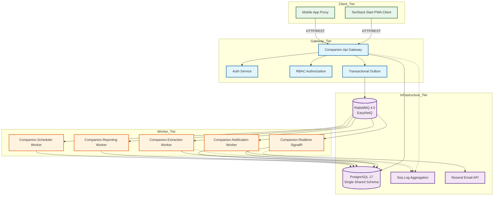

# As-Built Architecture

## Overview

The SARS Expense Companion is a .NET 10 microservices platform with a **single shared PostgreSQL 17 database** using a flat schema, **RabbitMQ 4.0** for event-driven messaging via EasyNetQ, and **JWT Bearer authentication** with ASP.NET Core Identity.

## Component Diagram

## Service Responsibilities

From Architecture.md Section 3:

| Service | Owns | Consumes RabbitMQ | Publishes RabbitMQ | Exposed to Client |
|---------|------|-------------------|-------------------|-------------------|
| Api (gateway) | Auth/RBAC, profiles, workspaces, expenses, billing, upload orchestration, report requests, outbox | Never | Via outbox relay only | Yes (HTTP) |
| Extraction | OCR, validity checks, VAT classification, result columns | Yes | Result/status events | No |
| Notification | Email (Resend), WhatsApp (planned) | Yes | No | No |
| Realtime | SignalR hubs, backplane | Yes | No | Yes (WebSocket) |
| Reporting | Scheduled and ad-hoc reports (PDF/DOCX) | Yes | Report-ready events | No |
| Scheduler | Cron-style jobs, stuck-Processing sweeper | No | Via events | No |

## Data Rules (from Architecture.md Section 4)

- **Database:** Single shared PostgreSQL 17, single flat schema. No schema-per-service, no DB-per-service.
- **Migrations:** Live in `Companion.Data`, applied on gateway startup only. Workers run a pending-migration check and fail fast if migrations are pending.
- **Keys:** All entity PKs are `int` identity. Every API-exposed entity has a separate `PublicId` (Guid).
- **Money:** `long AmountInCents` end to end. Never use decimal/double for stored amounts.
- **Naming:** snake_case tables and columns. Plural table names. Timestamps are timestamptz, UTC only.
- **Write ownership:** Extraction writes only result columns. User-origin data always wins.

## Messaging Architecture

### Messaging Rules (from Architecture.md Section 5)

- All RabbitMQ access goes through `Companion.Messaging` (EasyNetQ). No service references EasyNetQ or RabbitMQ.Client directly.
- Use existing generic publish/subscribe methods. Never create new messaging methods.
- EasyNetQ default conventions (type-based naming).
- Transactional outbox in the gateway: domain write + outbox row in one DB transaction; a relay publishes.
- Event naming: past tense, `<Thing><Happened>Event`. Additive changes only.

### Event Contracts

From `Companion.Events`:

| Event | Purpose | Publisher | Subscribers |
|-------|---------|-----------|-------------|
| EmailVerificationRequested | Auth email verification OTP | OutboxPublisher | Notification |
| PasswordResetRequested | Password reset OTP | OutboxPublisher | Notification |
| ReceiptUploadedEvent | Receipt capture submitted | OutboxPublisher | Extraction, Realtime |
| ReceiptProcessedEvent | OCR extraction complete | Extraction (planned) | Realtime, Reporting |

**Known risk (R-4):** Auth email events carry OTP/reset secrets in plaintext.