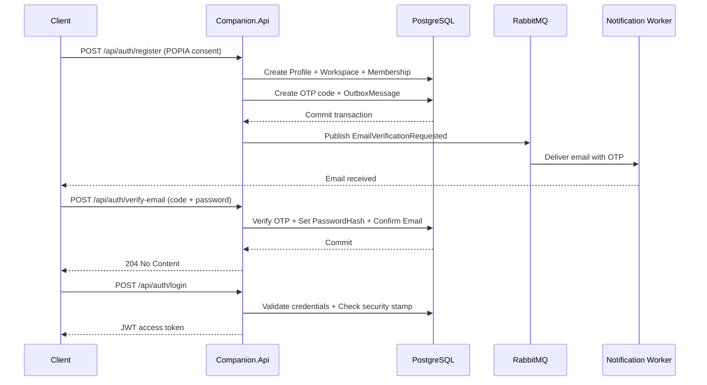
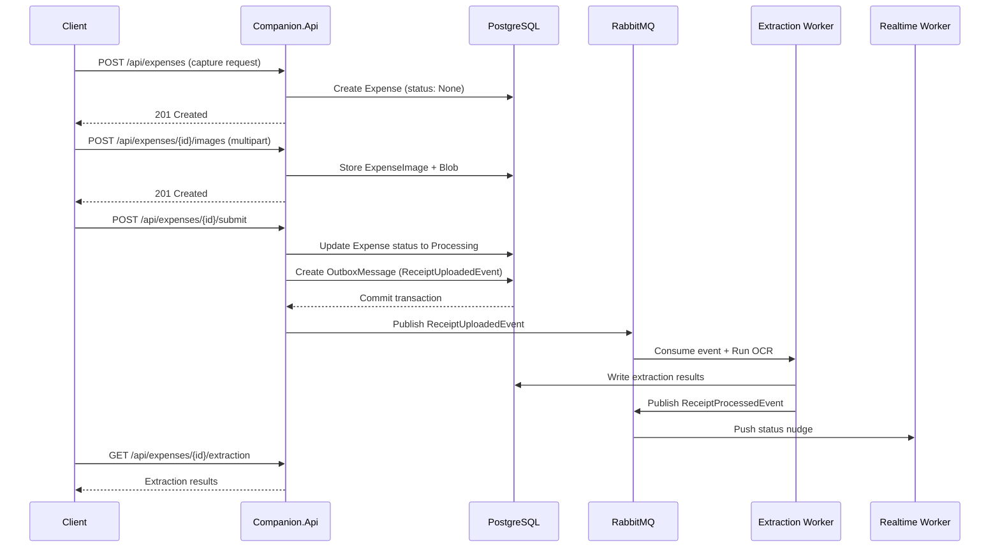

# Critical Business Workflows

## Workflow Summary

| Workflow | Impact | Test Coverage | Missing Validation |
|----------|--------|---------------|-------------------|
| Registration + Email Verification | Critical | High | Email delivery |
| Login | Critical | High | None |
| Receipt Capture Initialization | Critical | High | Tier limits |
| Image Upload + Submission | Critical | High | Extraction worker |
| Password Reset | High | High | Email delivery |
| Google OAuth Login | High | High | None |
| Profile Management | Medium | Medium | None |
| Extraction Status Query | Medium | Medium | None |
| Reporting | Medium | None | Not implemented |
| Scheduler Jobs | Medium | None | Not implemented |

## Workflow 1: User Registration and Email Verification

**Entry Point:** `POST /api/auth/register`

**Services:** Companion.Api, Companion.Notification (not implemented)

**Events:** `EmailVerificationRequested` (outbox)

**DB Changes:** Profile, Workspace, Membership, OTP code, OutboxMessage

**Outcome:** User verifies email, sets password, logs in.

**Failures:** Wrong/expired code → 400; Max attempts → locked; Code reused → 400

**Tests:** AuthApiTests covers registration, verification, resend, cooldown, single-use.

**Missing:** Email delivery (Notification worker not implemented).

**Impact:** Critical

## Workflow 2: User Login

**Entry Point:** `POST /api/auth/login`

**Services:** Companion.Api

**Events:** None

**DB Changes:** None (read-only)

**Outcome:** JWT access token (15 min expiry).

**Failures:** Wrong password → 401; Unconfirmed → 401; Locked → 401; Security stamp changed → rejected

**Tests:** AuthApiTests covers valid credentials, unconfirmed, wrong password, stamp revocation.

**Missing:** None significant.

**Impact:** Critical

## Workflow 3: Receipt Capture Initialization

**Entry Point:** `POST /api/expenses`

**Services:** Companion.Api

**Events:** None (on submit)

**DB Changes:** Expense (status: None), Advisory lock

**Outcome:** Expense created, 201 Created.

**Failures:** No workspace → 409; Multiple memberships → 409; Duplicate ID → Idempotent

**Tests:** ImageApiTests covers initialization, concurrent requests, idempotency.

**Missing:** Tier limit (20 expenses/month).

**Impact:** Critical

## Workflow 4: Image Upload and Submission

**Entry Point:** `POST /api/expenses/{id}/images` then `POST /api/expenses/{id}/submit`

**Services:** Companion.Api, Extraction (not implemented), Realtime (not implemented)

**Events:** `ReceiptUploadedEvent` (outbox)

**DB Changes:** ExpenseImage, Expense→Processing, OutboxMessage

**Outcome:** Images stored, expense Processing, event published.

**Failures:** Invalid image → 415; Oversized → 413; No images → 409; Already Processing → 409

**Tests:** ImageApiTests covers upload lifecycle, tenancy, submission, rollback.

**Missing:** Extraction worker, Realtime push not implemented.

**Impact:** Critical

## Workflow 5: Password Reset

**Entry Point:** `POST /api/auth/forgot-password`

**Services:** Companion.Api, Companion.Notification (not implemented)

**Events:** `PasswordResetRequested` (outbox)

**DB Changes:** OTP code, OutboxMessage, PasswordHash + SecurityStamp on success

**Outcome:** User sets new password, logs in.

**Failures:** Wrong code → 400; Weak password → 400; Expired → 400; Unknown email → 202

**Tests:** AuthApiTests covers forgot/reset, weak password, cooldown.

**Missing:** Email delivery.

**Impact:** High

## Workflow 6: Google OAuth Login

**Entry Point:** `POST /api/auth/google`

**Services:** Companion.Api

**Events:** None

**DB Changes:** Profile, UserLogin, Workspace (new users)

**Outcome:** JWT issued.

**Failures:** Invalid token → 401; Missing consent → 400; Non-Gmail → 401; Existing password → 401

**Tests:** AuthApiTests covers new/existing user, invalid token, consent, email authority.

**Missing:** None significant.

**Impact:** High

## Mermaid Sequence Diagrams

### Registration and Verification Flow

### Receipt Capture and Submission Flow

